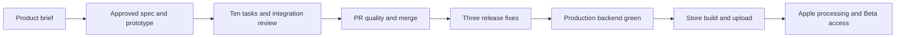

# Save + Today's 5: release proof needed to start earlier

Retrospective written 2026-11-12 for [Redesign Link Discovery App](t3-thread://v2/4718b5fe-85e1-4755-8df6-92d7be5488df/7257fd1a-d584-49c6-8d70-91941055b26c). Evidence comes from its recorded outcomes, the [approved spec](../specs/mobile-reading-app/2026-11-09-save-and-todays-5.md), [task/review ledger](../specs/mobile-reading-app/2026-11-09-save-and-todays-5/tasks.md), committed fixes and linked workflow results. This is a historical assessment, not permission for future releases.

## Result

The brief became a product release, rather than only a visual redesign: durable capture, a finite daily reading set, reversible reading actions and content recovery. Ten implementation tasks shipped in [PR #250](https://github.com/pffreitas/cosmic-dolphin/pull/250). Three release fixes followed in [#251](https://github.com/pffreitas/cosmic-dolphin/pull/251), [#252](https://github.com/pffreitas/cosmic-dolphin/pull/252) and [#253](https://github.com/pffreitas/cosmic-dolphin/pull/253).

Final production head: `10e8ad56de7643fb404ca655c52a7cbab257e819`. Backend [43137645677](https://github.com/pffreitas/cosmic-dolphin/actions/runs/43137645677) passed tests, production migrations, both image deployments and worker startup. Mobile [43139079920](https://github.com/pffreitas/cosmic-dolphin/actions/runs/43139079920) passed quality checks and scheduled the production build/submission. **Version 1.0.0, build 15** finished upload and became available to the existing internal **Beta** group after Apple processing and the encryption declaration were verified.

The product's adoption/reading outcomes are not yet measured. Normal-session, physical-radio, live spoken accessibility, full native matrix and user-device installation evidence remain beta validation under the user's explicit exception. They were not converted into passing results.

## Keep these practices

- **Outcome-driven scope.** The finite daily set addressed “saved but never read.” The broader AI Library and cited-answer ideas stayed in the backlog. The approved spec settled real save/Undo/privacy contracts instead of treating sample prototype behavior as production requirements.
- **Independent integration review.** Review found problems that large passing suites missed. Root reproduced findings through actual account/provider/navigation/HTTP boundaries and preserved the assertions when fixing them.
- **Durable native capture first.** Queue/keychain/native ingress work preceded the visible shell. Unique IDs, account binding, retained local intent and server deduplication formed the recovery contract across processes.
- **Evidence tied to a candidate.** Source manifests, exact SHAs, signatures, capability inspection and public-config checks prevented old previews from being described as proof of later source. Metadata-only changes were distinguished from app changes.
- **Honest release gates.** Tests, migration success, container deployment, worker runtime, EAS upload and Apple availability were tracked separately. Temporary fixture identities and missing physical proofs stayed labelled.
- **Small corrective changes.** Release fixes preserved compiler coverage, original tests and runtime scope. The unsupported CLI was pinned instead of performing an unverified configuration migration; the Docker fix supplied its missing workspace instead of excluding contract tests.

## What cost time or increased risk

| Observed problem | Why it mattered | Change for future agents |
| --- | --- | --- |
| T-2 was initially blocked on an unavailable physical iPhone even though simulator/code work could continue. | The user had to clarify that the simulator was available. | Establish evidence availability early. Separate implementation progress from hardware proof and record exceptions only when authorized. |
| T-9's brief said `processing_failure_code` existed, while the approved task required adding it and the checkout lacked it. | A correct delegate stopped on the contradictory assignment. | Inspect starting code before writing a delegate brief. Resolve coordinator mistakes from the existing approved scope before asking the user. |
| Task-local success missed account and lifetime boundaries. | Four Critical and three High findings were found across the first two whole-feature review rounds. | Add the boundary matrix below to relevant integration proof, rather than relying on test count. |
| A cold CI root/auth test timed out although the field was visible in its failure tree. | An unchanged retry failed again; local warm runs had hidden the issue. | Reproduce cold bootstrap and await actual React/auth completion. Preserve timeouts/assertions; a successful diagnostic does not establish the exact cloud timing cause. |
| Release prerequisites were checked after the feature merge. | Three follow-up PRs were needed before TestFlight could start. | Test clean-checkout contract inputs, full Linux Docker builds and migration CLI/config/target semantics before final review. PR-only CI is not the deploy path. |
| The final review budget was consumed before deployment fixes. | Two explicit one-round extensions were needed, despite standing release authorization. | Include deployment readiness and review capacity in the plan. Keep the same ledger; never silently reset it. Ask about the actual budget exception, not release permission again. |
| A backend Actions run stayed queued for nearly three hours. Cancellation did not succeed. | The user had to ask what was happening. | Report the concrete queue state and next action promptly. Record unsuccessful cancellation accurately; identify one recovery run rather than repeatedly dispatching. |
| Heavy Docker compilation ran in a shared 2 GB VM. | Kernel OOM killed compiler processes and four existing database containers. | Inventory resources first and isolate image proofs. Restore only the affected prior state; readiness after recovery does not prove transaction preservation. |
| Repeated full-suite/artifact work and long status histories accumulated. | Evidence became expensive to reread; “next review, then TestFlight” updates did not make the current blocker easy to see. | Keep a concise current release summary. Rerun required/relevant checks after changes; broaden only for a new failure or concern. Reuse unchanged-source evidence with explicit limits. |
| Apple upload success was followed by a status-tool target ambiguity and missing export compliance. | A successful scheduling job and EAS submission still did not mean users could install the build. | Verify native identity/declarations and existing ASC credentials early; finish at Apple state plus intended-group assignment. |

## Integration boundaries exposed by review

All seven findings were corrected and independently verified. These are regression categories, not seven new mandatory test files for every change.

| Finding | Observed failure | Reusable proof |
| --- | --- | --- |
| SOL-1, Critical | Unmount dropped pending Undo/navigation feedback. | Delay ACK, navigate, then verify already-enqueued owner-bound writes and appropriate feedback. |
| SOL-2, Critical | A's private Home action-sheet title/collection state remained under B. | Switch accounts with a sheet open and a request active; local state must reset synchronously. |
| SOL-3, Critical | Confirmation edits left durable storage before PATCH ACK. | Hold create/PATCH ACKs, edit, relaunch/replay and Remove; retain the latest intent until reconciled. |
| SOL-4, High | Home Paste supplied a URL that Save ignored. | Navigate from the actual Home action to Save, including explicit owner-scoped prefill and clipboard attribution. |
| SOL-5, High | A public card opened an owner-only detail route and returned 404. | Exercise public-slug navigation and forbid private-cache fallback. |
| SOL-6, High | A 20,000-word HTTP response was 620,120 bytes despite the 500,000-byte ceiling. | Bound the complete serialized UTF-8 response using long words/escaping/Unicode; label partial text truthfully. |
| SOL-7, Critical | Save retained A's URL/private note after switching to B. | Test pending-create and accepted-confirmation states, stale submit/finish completions and preserved A-owned durable storage. |

The review ledger started at five rounds and ended at **7/MAX7 APPROVE** through two explicit extensions. Rounds 1–2 requested changes; rounds 3–7 approved their candidates. No open findings remained. Some supplemental tests first ran green and some sequencing deviated from strict test-first execution; those qualifications remain in the task record. Passing reruns do not rewrite the original failures.

## Release failures and their evidence

| Boundary | Actual outcome | Correction/evidence |
| --- | --- | --- |
| Fresh backend contract test | Compiled OpenAPI was missing on main `04535e9`; migrations/deploy skipped. | [PR #251](https://github.com/pffreitas/cosmic-dolphin/pull/251) adds `apispec:compile` before tests. |
| Migration CLI | [43117189627](https://github.com/pffreitas/cosmic-dolphin/actions/runs/43117189627) passed tests, then CLI 3 rejected `[inbucket]`. CLI 3 also changed push defaults. | [PR #252](https://github.com/pffreitas/cosmic-dolphin/pull/252) pins tested 2.122.1. A rename-only diagnosis was withdrawn after checking target semantics. |
| API Docker workspace | [43120547980](https://github.com/pffreitas/cosmic-dolphin/actions/runs/43120547980) passed tests/migrations, then full API compilation hit four `TS2307` client imports. Both deploys skipped. | [PR #253](https://github.com/pffreitas/cosmic-dolphin/pull/253) includes/builds the client explicitly after source copy. Install-time scripts are skipped deliberately; required runtime artifacts were inspected. |
| Worker production readiness | Spec deployment alone could allow a crash loop. | The final workflow checked packaged browser extraction, deployment wait and an actual `Starting to process queue: bookmarks` runtime marker. |
| Apple identity/status | Read-only EAS status could not resolve multiple native schemes/targets. | Scope the status lookup to the verified host bundle; existing EAS/account ASC credentials worked without a new login. |
| Apple compliance/access | Build 15 was `VALID` but `MISSING_EXPORT_COMPLIANCE`. The existing `app.json` false declaration was absent from the native host plist. | Apply that existing declaration to the exact upload; Apple reached `IN_BETA_TESTING` and the existing all-builds internal group acquired build 15 automatically. No new audience or rebuild. |

Final observed checks: backend **428 shared / 383 API / 10 worker**, mobile **303 plus one existing skip**. Earlier unchanged-source review evidence also covered web **335**, accessibility **173** and native XCTest **29**; these are not claimed as new production-head executions. Local loopback timing and signed capability results are not physical network or real-session proof.

Production [build 1101dd2c](https://expo.dev/accounts/cosmic-dolphin/projects/cosmic-dolphin/builds/1101dd2c-ff69-410e-85cb-b33182bda1b5) and linked [submission b69e2007](https://expo.dev/accounts/cosmic-dolphin/projects/cosmic-dolphin/submissions/b69e2007-39f6-40d6-83af-3b07100b61f7) finished. The original thread/task ledger records the final ASC/group reads. Raw private receipts remain local; the durable summary above does not depend on their continued availability.

## Documentation changes and follow-ups

This retro updates shared [AGENTS.md](../../AGENTS.md), makes [CLAUDE.md](../../CLAUDE.md) reference it, adds the [release runbook](../runbooks/backend-and-testflight-release.md), and corrects stale mobile, design, backend-test and deployment descriptions. The shared guidance now covers account/lifetime proof, serial test isolation, actual compiler inputs, Docker ownership, review continuity and precise release states.

The following remain follow-up work, not changes made by this documentation task:

| Follow-up | Owner/trigger | Done when |
| --- | --- | --- |
| Reconcile native export declaration with the approved app config. | Next iOS release owner, before another production build | Signed host plist contains the intended reviewed declaration; no `prebuild --clean` reset. |
| Extend premerge backend readiness coverage. | Next CI improvement owner | A fresh backend contract/image regression fails before merge rather than only during deployment. |
| Align the `test:db` convenience wrapper with the documented serial gate. | Next test-infrastructure owner | The wrapper supplies explicit local environment, fresh contract prerequisite and serial backend execution. |
| Give future task plans a compact current-state/evidence index and release preflight milestone. | Next plan coordinator | An agent can identify candidate, grant, proof, review budget and next gate without reconstructing the transcript. |
| Complete unavailable beta tests and product measurements. | Paulo/release operators under the approved spec | Real-session/device/accessibility outcomes and scheduled metric observations are recorded honestly. Any unexplained capture loss still blocks wider rollout. |

Do not change current production, reopen merged PRs, start another review loop, or declare product success merely to close these follow-ups. The user's authorization and the next task's scope determine subsequent action.
