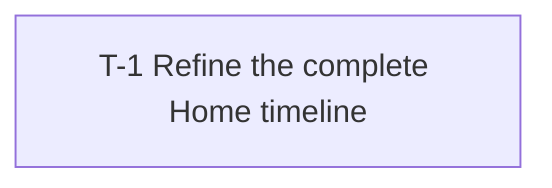

# Tasks: Unified mobile timeline

| | |
|---|---|
| Spec | [Unified mobile timeline](../2026-11-12-unified-timeline.md) · Status at breakdown: Approved |
| Spec revision | Approved semantic amendment FR-7/D-5, sha256:d875026f2535c361a802cd64edc95bce6ade216c58da063761a6fbe30bda411a |
| Generated with | `/Users/paulo.freitas/.agents/skills/spec-breakdown/SKILL.md` · sha256:f7d0c27c94c9196df40134b2544e6a766ad40a0ca0938e025ae974297b6d7d51 |
| Readiness | Spec §11 checked: written spec/prototype approved by Paulo Freitas on 2026-11-12; no unresolved service contracts or deferred product decisions |
| Prototype | [Approved standalone HTML](../unified-timeline-prototype.html); fictional fixtures, not production evidence |
| Status | Approved by Paulo Freitas on 2026-11-12 |
| Date | 2026-11-12 |
| Feature flag | N/A: direct Home-only refinement, one complete package; no flag authorized |
| Integration | Proposed feature branch `feature/mobile-unified-timeline` from fetched `origin/main` → one complete GitHub PR → `main`; squash merge |
| Delivery | github-pr |
| Authorization | User: “Approved, implement it and full send” (spec D-4), implementation/feature pushes/PR/review replies/merge after gates. Exact written spec/prototype approved through “Approve spec (Recommended)”; this task plan approved through “Approve plan (Recommended)” on 2026-11-12. No manual dispatch, backend release or TestFlight submission. |
| Plan | 1 task · critical path T-1 · 1 lane (A), no parallel developer work |

**Current outcome / next gate / owner / blocker.** [PR #256](https://github.com/pffreitas/cosmic-dolphin/pull/256) at 71d3c58 failed Rule ten shared-token coverage; Mobile lint/types/Jest passed. CI-1 test-only correction reproduced red and now passes locally (197 accessibility tests, full web381). Coordinator requests Sol round2/5 on the correction before pushing, then waits for exact-head CI and authorized merge. Native/app product behavior unchanged. Base remains d266cf4e83c0825c896325d230907e3c6133b876.

**Planning verification.** Structural checker passed with one task, zero errors/warnings. Coordinator fresh-eyes read found no missing dependency or outcome boundary; all work shares one developer context. Council final reads and independent simplification/editor passes are recorded in the spec; the HTML's tested revision is sha256:6accb830dceecf1cde51d251c9fbacbb2d86baaa508436a8433e893a75397942. Only spec, tasks and this standalone HTML are retained after planning cleanup.

**Source fingerprints.** References resolved under `/Users/paulo.freitas/.agents/skills/spec-breakdown/references/`: `tasks-template.md` sha256:2ea8bb77f84ae117af305ffd63f2d6e25ba87229a88150a0c366906bf6fdf366; `implementation-protocol.md` sha256:7b81479e1e3d6e6c8a3887dd7d3326c3d088974c18640eff4b830651d6f946c8; `slicing-patterns.md` sha256:ebb68edad332a3a6187e27632e08efa19d571f6759708a59c98dd908de6fbe22. Protocol copied below with only its named substitutions.

**Starting snapshot, not operational review approval.** Planning checkout: `/Users/paulo.freitas/ws/cosmic-dolphin`, unrelated `feat/landing-page` at `775674e33316acd807d08ec41c21cea2be20a81e`. Remote main observed at `d266cf4e83c0825c896325d230907e3c6133b876`; mobile sources were diff-verified identical. Initial dirty work comprised only this feature's untracked spec and prototype. Do not incorporate the landing-page commits. Re-fetch main and create an isolated implementation worktree; transfer only the approved spec, prototype and tasks. Operational base/head/review/PR fields below intentionally remain blank until execution.

## How to work this plan

Point a coding agent at this file ("Work the plan in `docs/specs/mobile-reading-app/2026-11-12-unified-timeline/tasks.md`") and it runs as the
**coordinator**. Developer subagents build the tasks test-first on `feature/mobile-unified-timeline`. The
coordinator verifies and commits each task there. Once every task is done, GPT Sol reviews
the whole feature through `sol-loop`, with at most 5 rounds for all tasks and repos together,
including meaningful fixes made during PR feedback. Deliver one GitHub PR per repo's complete
package, after implementation, proof and review. Merge only with explicit user full-send or
merge authorization and every gate passing. Without that grant, leave the PR ready for the
user. Task commits are implementation checkpoints; none is delivered separately to `main`.

| Role | Who | Does | Never |
|---|---|---|---|
| Coordinator | The agent pointed at this file | Picks tasks, verifies, commits on the feature branch, owns Sol review, PR delivery and this file | Writes product code |
| Developer | A fresh subagent per task | Builds one task, test-first | Edits this file, commits or pushes |
| Reviewer | One Sol reviewer per round in one ledger | Reviews the cumulative change and cross-task integration; re-reviews fixes | Edits any file, starts subagents or watches PRs |

Without developer subagent support, the coordinator may build tasks itself using the developer
brief and disclose the fallback. Final review still requires a route to GPT Sol; report a
missing route rather than substituting self-review or another model.

### Coordinator

Before the first task:

1. Check the spec and this file's *Status* and approval provenance. Both must be `Approved` at
   their authorized semantic revisions; otherwise stop and ask. A lane-only assignment
   authorizes that lane's implementation, not integration of an incomplete feature. Ask before
   resuming or skipping an `In progress` task whose ownership or state is unclear.
   Confirm `Delivery: github-pr` matches the spec's delivery rules. Record the actual user
   execution request in *Authorization*; approval of this file alone never authorizes merging.
   An explicit full-send request authorizes feature pushes, PR/review replies and merge after
   the gate. It permits `--force-with-lease` only for an authorized rebase of this task's own
   feature branch; never force-push the target or another/shared branch. Otherwise do not rebase
   published history without permission. Keep scope and manual rollout owners unchanged.
2. In every repo, confirm `origin` and `main`, inspect the working tree and fetch the
   target. Preserve the approved tasks file; other pre-existing dirty work requires a separate
   worktree or the user's direction. Never discard it. Create `feature/mobile-unified-timeline` from the fetched target in an
   isolated worktree where available. On resume, use the recorded branch and review state;
   never recreate it or reset the round count. Preserve an approved uncommitted tasks file by
   committing it on the feature branch; it need not be pushed to the target before work starts.
3. Resolve `sol-loop`, `file-pr`, `babysit-pr` and `leaving-pr-comments` from installed skills.
   Confirm authenticated GitHub CLI and a route to the requested/latest available GPT Sol.
   Outside T3, confirm Python 3 for `pr-wait`. Run *Verify all* on the starting target snapshot.
   If it is already red or a required tool is unavailable, stop and report it.
4. In *Delivery*, reuse or record each repo's branch, target and existing PR URL; do not create
   a duplicate PR. Verify live state on resume. In *Implementation review*, record each repo's
   feature branch and full target SHA as Base
   SHA, with verdict `Pending` and rounds `0`. For a legacy plan whose task commits already
   landed on the target, preserve them and report that history: this package contains only the
   remaining delta. Do not claim the earlier work will ship with this package or undo it.
   Preserve already-used review rounds/findings and merged PR history when resuming.
5. Confirm every task can be completed before package integration. A task depending on rollout
   of this same package creates a cycle. Report it as a plan problem; do not integrate a subset
   to unblock it. Post-launch cleanup or required staged deployments need an explicitly agreed
   separate plan/package or a revised spec before implementation proceeds.

For each task:

1. **Pick.** Choose the lowest-numbered `Todo` task whose task dependencies are `Done` and whose
   external rollout prerequisites are complete. If no task is ready and any non-`Dropped` task
   remains unfinished, report the blockers and preserve the feature branch. Do not integrate.
2. **Start and build.** Set Status to `In progress` and spawn a developer with the developer
   brief in the task's feature worktree.
3. **Verify and checkpoint.** Run the task's *Verify* commands yourself and the required lint
   and type checks. Send failures to the developer until green, or block the task if it cannot
   proceed. These are implementation checks, not review rounds. Check the developer's report
   accounts for the acceptance criteria. Run broader checks when the task or repo requires them.
4. Set Status to `Done` and record results in *Notes*. Commit the task on the feature branch
   using *Repo conventions* with a `Task: T-n` trailer. If the task is in another repo, record
   its code commit SHA in the tasks file and commit the status change on that file's feature
   branch. `Done` means implemented, verified and committed on the feature branch; it does not
   mean reviewed, integrated or shipped.
5. **Blocked work.** Preserve unfinished code in a local `wip/mobile-unified-timeline-<T-n>` branch based on the
   feature checkpoint; keep its branch name and reason in *Notes*. Return to the clean feature
   branch and mark the task `Blocked`. Continue independent tasks, but hold the entire package
   until every task is done. Do not push blocked work to `main`.
6. Continue without per-task review, target merges or target pushes. Feature-branch backup
   pushes are optional when authorized and repo checks pass; they are not package delivery.
   Do not open a package PR until all required tasks in all repos are done and final review
   passes. A blocker holds the whole package while independent local implementation continues.

### Final implementation review

1. **Ready.** Start only after every non-`Dropped` task in the whole plan is `Done`, including
   all lanes. If the saved review has used 5 rounds without approval, report it and stop unless
   the user directs further review. An incomplete plan cannot earn package approval.
2. **Prepare the candidate.** Fetch every target and update the feature branch to include its
   latest SHA using the approved repo strategy. Resolve conflicts through the owning developers.
   Record that target SHA as Base SHA
   and the candidate feature HEAD as Reviewed SHA. Run *Verify all* and every task-specific
   check it does not cover in every repo; include required integration, security and CI checks
   from *Repo conventions*. Local proof must pass before review. If a required CI job runs only
   on a PR, declare that trigger in *Repo conventions*; it remains a merge gate and runs after
   the reviewed feature is pushed. Never treat unavailable PR-only CI as green or require it
   before the PR that triggers it can exist. A required pre-PR staging/UAT check still blocks.
3. **Review.** Use `sol-loop` approved-plan mode with this reviewer brief, spec/prototype paths,
   all Base/Reviewed SHAs and the task-to-commit
   mapping. It reviews the entire cumulative feature diff and cross-task contracts. One pass
   across all tasks and repos is one round. Store its verdict, round count and findings in
   *Implementation review*; commit the record on the feature branch. This is the only final
   implementation review loop; do not add a separate generic Sol loop. The plan's 5-round cap
   replaces sol-loop's standalone budget. Every required acceptance criterion, failure, NFR
   and repo check is in scope regardless of how frequently the path occurs.
4. **Batch fixes.** For `CHANGES REQUESTED`, with fewer than 5 rounds used, send all findings
   together to the affected developers. Fix every Critical and High finding or dispute it with
   evidence. Group fixes by owning task; use dependency order and non-overlapping *Touches*
   for parallel work. A spec gap blocks resolution. Verify and commit fixes on the feature
   branch, then request the next round with the same ledger, all fixes and disputes. In T3,
   every delegated review round is a fresh `delegate_task`; follow its returned next action, never poll or send
   re-review to an old child thread. Repeat from preparation;
   verification retries do not count as review rounds.
5. **Outcome.** `APPROVE` requires no open Critical or High finding. Record accepted Medium/Low
   follow-ups with task IDs. Five rounds without approval leave the package on its feature
   branch; report the findings and stop. Do not reset the cap or mark implemented tasks `Blocked`.
   Approval applies to the recorded Base/Reviewed SHAs. Product-code changes or new target
   commits require fresh verification and reviewer approval of the updated candidate, using
   the same remaining round budget. Review-record-only commits do not invalidate semantic
   approval, but required GitHub checks must still cover the final pushed head. Behavior fixes
   during PR babysitting use this same ledger and remaining rounds. Exhaustion is not approval.

### Deliver the complete package

1. **Gate.** Every non-`Dropped` task must be `Done`, the whole-feature verdict must be `APPROVE`,
   and local proof must pass for the candidate being delivered. Fetch each target
   again. If any differs from its recorded Base SHA, return to review preparation; never
   deliver using stale approval. Confirm the pushed product tree is the reviewed tree; re-run
   relevant proof and review for code changes or meaningful conflict fixes.
2. **File or update the PRs.** Push the feature branch, never `HEAD:refs/heads/main`.
   Use `file-pr` for one non-draft PR per repo's complete package against its recorded target.
   Include the spec/tasks links, outcome, proof and review result; follow the repo's merge
   method, including squash-only rules. Preserve task-to-commit provenance in this plan even
   when GitHub squashes the PR. In T3, call `link_pull_request` as the next tool call after
   creating, taking over or pushing to each PR. Record PR URL and actual head/base in *Delivery*.
3. **Babysit.** Use `babysit-pr`. Verify each bot finding against the spec and source. Route
   real fixes to owning developers, rerun proof, and obtain current Sol review coverage through
   the same ledger before pushing behavioral changes. Reply with evidence when dismissing a
   finding, using `leaving-pr-comments`. Do not change required behavior or weaken tests to get
   green. Persist actionable state before waiting. In T3, only the package coordinator calls
   `watch_pull_request` if not already active and ends the turn; wakes resume work without
   removing the watch, so do not rearm it on each wake. Never poll or sleep. Outside T3,
   use that skill's `pr-wait`. A watcher's ready result is not permission to merge.
4. **Live merge gate.** Every task is `Done`; all repos have current Sol approval and proof;
   all required checks pass on each final PR head; required reviewers/bots have finished;
   findings are fixed or dismissed with a written reason; no human requests changes; required
   human approvals are present; the PRs are open, non-draft, up to date and mergeable. Fetch
   targets again and compare live heads/bases to the recorded candidates immediately before
   each merge. Unknown, pending, BEHIND or DIRTY is not ready. A new base or behavior change
   returns to verification/review with the same remaining round budget and fresh head checks.
   Check exact merge candidates when the repo requires them; do not substitute branch-only proof.
5. **Merge or hand off.** With explicit full-send or merge authorization, merge through GitHub
   using the repo's allowed method and branch protection; never use `--admin` or another bypass.
   Stay watching until a merge queue/auto-merge actually completes. Without merge authorization,
   never enable auto-merge or enter a queue; disable existing automatic merging before any push
   or report the blocker if unable. Leave the PR open for the user at the gate. A subsequent
   full-send request can resume the same ready PR without repeating unchanged implementation.
6. **Multiple repos.** Verify the gate across every repo before the first merge. Merge in the
   spec's compatibility order and recheck the remaining candidates before their merges.
   Separate PR merges are not atomic: a failure after one succeeds holds the remaining PRs
   and must report each merged SHA and pending result. Never force-push a rollback or claim
   the whole feature shipped. A deployment required between changes needs a separately agreed
   package or named operator step; do not silently perform manual rollout to unblock delivery.

**Finish or resume.** Persist PR URLs, head/base SHAs, review rounds/findings, observed proof,
check results, decisions and per-repo delivery state in this file. After a merge, record the
merge SHA locally and in the final report; do not reopen a merged PR or push to the target just
to publish bookkeeping. A completion report requires all package PRs merged. A ready handoff
states they remain open/unmerged; a partial merge reports every repo separately. Manual rollout
remains with its named owners and starts only after its declared package prerequisites.

Ask through the harness question tool when a consequential gap, missing proof, exhausted
review budget or unfixable gate prevents progress. Preserve branches and unresolved findings.
Before a question or blocked/ready handoff in T3, call `unwatch_pull_request` on every PR you
watch. On resume, inspect live PR state and reuse checkpoints and rounds; an installed-skill
update or missing scratch files never resets approvals or the review budget.

**Never** integrate an individual task into `main`, push an incomplete or unapproved package,
skip or weaken a required check, bypass protection, force-push outside the own-branch grant,
or change task scope, criteria or order. Record
plan problems in *Notes* and the final report for the breakdown to resolve.

**Parallel work.** One coordinator owns the feature branches, review record and final package
delivery. Developers can work in isolated task worktrees when dependencies are met and
*Touches* do not overlap. The coordinator collects their changes on the feature branch and
checks them there. Lane coordinators may help implement scoped work, but only the designated
package coordinator performs whole-feature review, watches PRs and merges after all lanes finish.

### Developer brief

```
You are the developer for <T-n> in docs/specs/mobile-reading-app/2026-11-12-unified-timeline/tasks.md. Read the file header, *Repo conventions*,
task <T-n> and the spec sections it cites. You do not need the other tasks.

Build it test-first, one behaviour at a time, in the order of the task's *Tests* list:
1. Red: write one test for the next acceptance criterion. Run it. It must fail, and for the
   reason you expect.
2. Green: write the least production code that makes it pass.
3. Repeat for the next criterion. Refactor only when green, and re-run the tests after each
   step.
Tests go through public interfaces and assert behaviour, not implementation. Do not write all
the tests first. If you have a TDD skill or a skill for this stack, use it.

Follow *Repo conventions* and the stack guidelines it names, and match the surrounding code.
Build only the *Scope*. Do not edit the tasks file, commit or push.
Before you report done, run every *Verify* command and the lint and type checks in *Verify all*.

If the task or the spec is missing, contradictory or wrong, stop and report BLOCKED with the
reason. Do not work around a gap.

Report: the files you changed; the tests you added, each confirmed failing before its code;
Verify results; decisions you made; anything outside the Scope you noticed.

When you receive review findings: fix every Critical and High finding. Fix a Medium or Low
finding when it is inside the Scope and small; otherwise say why not. Dispute a finding only
with evidence (code, spec, test output), never to save work. Then report again in the same
format, with one line per finding: fixed, or disputed and why.
```

### Reviewer brief

```
You review the whole feature in docs/specs/mobile-reading-app/2026-11-12-unified-timeline/tasks.md. Read the header, *Repo conventions*,
*Implementation review*, every task and its cited spec sections. The coordinator supplies
Base SHA (the current target), Reviewed SHA (the feature candidate) and task commits for every
repo. Do not edit any file.

Inspect `git diff BASE_SHA REVIEWED_SHA` and `git log BASE_SHA..REVIEWED_SHA`, including new
files. Run *Verify all* against the supplied candidate and task-specific checks it does not
cover. Review the final package; task checkpoints do not have to be independently deployable.
Then check:
1. Every acceptance criterion holds and has meaningful behaviour coverage through public
   interfaces. No test is skipped, weakened or deleted to get green.
2. The implementation stays inside the combined task scopes and the spec. A task's *Out of
   scope* may be delivered by another included task; that is not scope creep.
3. The complete feature's *Ships as* holds, including specified flag-off behaviour. It is
   releasable after integration into main, with no incomplete required behaviour.
4. The code is correct, secure and handles the spec's named failures and existing regressions.
5. Cross-task and cross-repo contracts, wiring, migrations, flags and telemetry agree. Check
   the full user path, compatibility and integration coverage.
6. It follows *Repo conventions*, stack guidelines and surrounding code. The package follows
   the spec's deployment order without requiring an unreviewed partial target integration.

Severity:
- Critical: breaks the build or target, loses data, opens a security hole, fails an acceptance
  criterion, or exposes behaviour the spec should hide.
- High: a bug on a likely path, an acceptance criterion without real coverage, work outside
  combined scope, or a rule that CI or architecture tests will reject.
- Medium: a maintainability problem or an unhandled edge case the spec does not name.
- Low: naming, style, nits.

Report APPROVE (no open Critical or High finding) or CHANGES REQUESTED first. Then a table:
ID, severity, repo/file:line, task IDs, problem, fix. Cite applicable criteria or spec rows.
On re-review, mark every earlier finding fixed, still open, dispute accepted or dispute
rejected with evidence, then list new findings. Review changed code and its interactions;
raise a new finding on unchanged, already-reviewed code only if it is Critical.
```

## Repo conventions

- **Repo / remote / target:** single `cosmic-dolphin` monorepo, `origin`, target `main`. Read `AGENTS.md` before implementation; preserve unrelated work, environment files and agent hooks.
- **Stack and guidelines:** Bun/Turborepo; Expo 54, Expo Router 6, React 19.1, React Native 0.81.5, TypeScript 5.9, Jest 29/Testing Library. Read `docs/design-system/README.md`, `docs/functional-spec/README.md`, `docs/specs/mobile-reading-app/2026-11-09-save-and-todays-5.md` (only its FR-29 scopes are superseded), `apps/mobile/eslint.config.js`, `apps/mobile/tsconfig.json`, `apps/mobile/package.json`, and surrounding tests. Keep committed native projects intact; never `expo prebuild --clean`.
- **Build:** root `bun run apispec` prepares the generated client; native local app scripts are `bun run --cwd apps/mobile ios` / `bun run --cwd apps/mobile android`. No manual EAS/production build or dispatch is granted. Use existing native projects and the task-owned device claim for runtime proof.
- **Test:** `bun run --cwd apps/mobile test -- --ci --runInBand`; focused example `bun run --cwd apps/mobile test -- --ci --runInBand --runTestsByPath app/__tests__/today-feed.test.tsx`.
- **Lint / type-check:** `bun run --cwd apps/mobile lint`; `bunx tsc --noEmit -p apps/mobile/tsconfig.json`.
- **Tokens:** edit only source `docs/design-system/tokens.json`; `bun run tokens` regenerates themes, then `bun run tokens:check`. Document mobile header semantics in `docs/design-system/foundations.md`. No hard-coded component colors/radii/font stacks, no hand edits to generated themes. Preserve effective web tokens.
- **Verify all**: `bun run apispec`, `bun run --cwd apps/mobile lint`, `bunx tsc --noEmit -p apps/mobile/tsconfig.json`, `bun run --cwd apps/mobile test -- --ci --runInBand`, `bun run tokens:check`; run from repo root, individually, on starting main and the implementation candidate:

```bash
bun run apispec
bun run --cwd apps/mobile lint
bunx tsc --noEmit -p apps/mobile/tsconfig.json
bun run --cwd apps/mobile test -- --ci --runInBand
bun run tokens:check
```

- **Additional candidate proof:** T-1's native/transport/privacy/default-style checks below; inspect cumulative diff for zero new dependencies/endpoints/API enums/cache/persistence changes and zero effective web-color changes. Retain generic feed scope tests.
- **Shared-token CI proof:** when canonical color roles change, also run the exact Rule ten workflow commands locally: web accessibility tests, full web tests and web lint plus mobile token lint. Add explicit measured compositions to `apps/web/__tests__/accessibility/contrast.test.ts`; never exempt contrast-bearing tokens or weaken global coverage.
- **Required checks / triggers:** local Verify all before review/push; PR-triggered `Mobile lint, types and Jest` in `.github/workflows/mobile-pr.yml` and `Rule ten` in `.github/workflows/accessibility.yml`, after PR creation and before merge. Check exact live names, current rules/reviews and final head/base; pending/unknown is not passing. Main push triggers `Mobile Quality Checks` and configured iOS/Android preview scheduling in `.github/workflows/deploy-mobile.yml`, not pre-PR proof.
- **Merge method / protection:** squash as spec §8.9 requires. Planning discovery found no enforced main protections/rulesets; this never waives local proof, cumulative Sol approval, PR checks or feedback resolution. Re-read live rules at delivery; no bypass. Update feature from current target via ordinary merge (no published rebase needed); any changed product/base needs renewed proof/review within the same budget.
- **Feature flag:** none; do not add a rollout flag, new hook or temporary endpoint.
- **Commits:** Conventional Commits; implementation checkpoint trailer `Task: T-1`. Preserve task→code commit mapping in Notes and PR even though final merge is squash. Do not commit/push this plan from the unrelated landing branch.
- **Supporting skills / Sol:** resolve `sol-loop`, `file-pr`, `babysit-pr`, `leaving-pr-comments` and `tdd` by installed skill name, not relative to the task folder. Latest current-provider GPT-6.1 Sol route was validated in orchestrator capabilities during discovery; confirm live route at execution. One cumulative ledger, maximum five Sol rounds including PR fixes and target updates; never reset it or substitute self-review.

**Baseline evidence and cache caveat.** Planning checks on the mobile-equivalent checkout passed API generation, mobile lint (12 existing warnings), token drift, and Jest (36 passing suites / 303 passing tests; one existing suite/test skipped). Raw TypeScript initially failed against stale ignored `apps/mobile/.expo/types/router.d.ts` containing old routes. A scratch config with the same product-source coverage and absolute typeRoots, excluding only `.expo`, passed. This diagnoses a local environment cache, not a product baseline failure and not permission to weaken checks. Run the exact original TypeScript command in the fresh implementation worktree without copying `.expo`; do not delete the user's cache, edit tsconfig, suppress errors or substitute the scratch config. A real fresh-worktree failure blocks execution. These planning observations are not implementation-candidate proof.

## Plan at a glance

**Granularity rationale.** Working budget 1, final count 1. One Home refinement shares composition, owner/topic lifetime, appearance primitives and a single fixture strategy. One developer keeps all shared files and states in context; splitting tokens, privacy or tests would fragment the same observable outcome and repeat handoffs without an independently useful boundary. M means roughly half a day to two days of focused implementation and verification, not a promise or a line-count limit. Native evidence and the review burden are included. This complete task is the walking skeleton and full capability on the real authenticated Home entry; no prerequisite or rollout cycle exists.



| ID | Title | Depends on | Lane | Touches | Size | Ships as |
|---|---|---|---|---|---|---|
| T-1 | Refine the complete Home timeline | none | A | `apps/mobile/app/` · `apps/mobile/components/` · `apps/mobile/constants/` · `docs/design-system/` · token-generator outputs | M | User-visible: unified finite Home with black persistent header and owner-safe topics |

## Tasks

### T-1 · Refine Home into one finite timeline with a persistent black header and owner-safe topics

| | |
|---|---|
| Status | Done |
| Execution | Started 2026-11-12 after all baseline checks passed |
| Depends on | none |
| Traces | G-1 · FR-1–FR-7 (all criteria) · NFR-1–NFR-4 · S-1 (all states) · §8.1–8.9 · §9 risks · D-1–D-5 · §11 readiness |
| Ships as | User-visible: existing ranked for_you Home without scope controls, All topics first, black persistent header; existing reading/save behavior preserved |
| Size | M |
| Touches | `apps/mobile/app/` · `apps/mobile/components/` · `apps/mobile/constants/` · `docs/design-system/` · token-generator outputs |

**Goal.** On the real authenticated Home entry, the complete approved composition, topic/privacy boundaries, Home-only appearance and existing save/read flows work together on one verified feature checkpoint. No other screen or backend behavior changes.

**Context.** Read approved spec §§3–11 and the standalone prototype linked above. Grounding paths: `apps/mobile/app/(tabs)/index.tsx` (`HomeScreen`, `ContinueReading`), `apps/mobile/hooks/useHomeFeed.ts` (existing `for_you` composition/owner fences/finite behavior), `apps/mobile/lib/home-editions.ts` (`topicName`), `apps/mobile/components/ui/Signal.tsx` (`Screen`, `Chip`), `apps/mobile/components/TopBar.tsx` (`TopBar`, `TopBarAction`), `apps/mobile/components/BrandMark.tsx` (`BrandSignature`). No new feed wiring is needed. Topics are derived from loaded feed bookmark `cosmicTags`, in existing order, not a Library-wide taxonomy.

**Scope**

- `apps/mobile/app/(tabs)/index.tsx`: pass constant `"for_you"`; remove Home scope state, controls and unreachable alternate-scope branches/imports. Keep the current finite ranked picks/Continue/tail composition, reason labels, deduplication, capture statuses, maximum ten-item tail and Library exit. Render the horizontal topic strip as a sibling above FlatList, beneath the brand bar, always starting with All topics; no sticky-scroll machinery.
- In that Home composition, fence topic/selection/derived owner data synchronously on account change and reject old-owner completions. Same-owner reader/tab return and transient loading retain selection. Only a completed same-owner refresh that removes the selected topic falls back to All topics. Topic filtering remains local and tail-only; picks/progress, Continue and capture status are not filtered. Preserve provider/cache/action owner fences rather than replacing them with an effect-only local reset.
- `apps/mobile/components/ui/Signal.tsx`, `apps/mobile/components/TopBar.tsx`, `apps/mobile/components/BrandMark.tsx`: optional Home-only appearance inputs for safe area/header, brand without gradient capsule, white actions, topic states and focus treatments; shared defaults stay unchanged. Keep body styling independent of black safe-area/header styling. Restore normal status/navigation appearance off Home, including when a tab remains mounted. Use existing navigation/status-bar lifecycle patterns; no global recoloring.
- `docs/design-system/tokens.json` and existing design-system docs: semantic mobile header tokens and documented meaning; run token generation for `apps/mobile/constants/theme.ts` and other generated outputs without effective web-color changes. No invented exact token key is prescribed: use existing token schema and semantic naming for the approved roles.
- Approved FR-7 prerequisite exception: `apps/mobile/android/app/src/main/java/com/cosmicdolphin/app/MainActivity.kt` moves configureSplashSystemBars immediately after Expo splash registration, still before super.onCreate. Reproduce the gray native title-bar occlusion, add a focused startup-order regression consistent with existing native source-contract tests, and prove actual Android cold-launch/splash/both themes/non-Home UI. No manifest/theme/release-identity/native-regeneration changes.
- Extend behavior tests in `apps/mobile/app/__tests__/today-feed.test.tsx`, `home-navigation.test.tsx`, `topic-state.test.tsx`, `bookmark-reading.test.tsx` / `bookmark-failure.test.tsx`; primitive tests in `apps/mobile/components/ui/__tests__/Signal.test.tsx` and `contrast.test.ts`; token tests in `apps/mobile/constants/__tests__/theme.generated.test.ts`. Add adjacent focused tests where needed for Home integration/appearance. Read `apps/mobile/hooks/__tests__/today-feed-cache.test.tsx`, `apps/mobile/lib/__tests__/today-feed-api.test.ts` and existing provider/action tests for transport and held-completion fixtures; retain their generic scope coverage and existing assertions. Privacy proof must exercise Home through the real provider/navigation/transport boundary, not only a mocked hook or cache unit test.

**Out of scope**

- Today’s 5 swipe/reels viewer or header pill/action; chronological union, ranking rewrite, pagination/endless feed, social features, Library/web redesign, full-Library topic taxonomy or persisted topic preference.
- New feed hooks, endpoints, dependencies, schemas/migrations, cache keys, API scope enums, data access/permissions, motion or telemetry. Shared generic scope support and public/private routing stay intact. No API-client manual edits.
- Landing-page work, unrelated refactoring, native regeneration, manual workflow dispatch, backend release or TestFlight build/submission. Manual rollout/rollback remain Paulo's responsibility.

**Acceptance criteria**

The spec states requirements and shared criteria rather than numbered Given/When/Then cases; the following observable cases map those exact obligations without changing scope.

- [ ] On authenticated Home, use the existing `for_you` feed without For you, Following or Unread scope controls; retain picks/reasons, deduplication and maximum ten-item tail. (FR-1; FR-1/6 shared AC; G-1)
- [ ] All topics is always first, including no-topic/loading/error states; it initializes selected on fresh Home mount and account change. Same-account ordinary reader/tab return preserves the selected topic. (FR-2; S-1)
- [ ] Topic→All topics restores the local tail without requests; derivation/order and server ranking stay unchanged. Picks/progress, Continue and capture statuses remain unfiltered. (FR-2/3 shared AC; FR-3; NFR-1)
- [ ] On account A→B while a topic, request or action sheet is active, A topics, selection and content are never presented as B; held old-owner completions cannot affect B. Component-local privacy is covered through Home/provider integration as well as existing cache/action fences. (NFR-2; §8.6 account row; §8.7)
- [ ] A completed same-owner refresh that removes the selected topic selects All topics; transient loading alone does not reset it. No-topic/failure/offline retain All topics and existing loading/retry/cache notices. (§8.6 refresh and no-topics rows)
- [ ] Home safe area, brand/action bar and persistent topic strip are solid black in both themes, with white controls and no gradient brand capsule. Topics stay beneath the bar while content scrolls. Body and other screens retain existing styling and primitive defaults. Search/profile and status-bar glyphs remain readable, and leaving Home restores normal appearance. (FR-4 and shared AC; S-1; §9 shared-styling risk)
- [ ] No Today’s 5 header pill or dead viewer action is exposed; inline daily picks/progress remain. (FR-5 and shared AC)
- [ ] Refresh, skeleton loading, first-run/no-picks empty, whole/partial failure Retry, offline cache/notice, capture processing, completed content/Undo, reading/navigation, Done/Later/Undo and Save remain usable; owner-bound actions and public-slug routing are unchanged. Preserve finite feed/Library exit and do not paginate even if a cursor is returned. (FR-6; S-1; §8.4, §8.6 cursor row; §8.7)
- [ ] Header reading/focus order is brand, Search, Your profile, All topics, available topics, content. Text contrast is at least 4.5:1, meaningful focus/control contrast at least 3:1 and targets at least 44px. No lost controls at font scales 1 and 2 in both themes. Native typography is authoritative; no new motion/permissions. (NFR-3; S-1)
- [ ] No new endpoints/dependencies/topic-selection requests or effective web-color changes; generated-token drift passes and shared default regression tests pass. (NFR-1; §§8.1–8.4)
- [ ] Complete mobile Jest, mobile lint, exact TypeScript, API generation and token drift checks pass; native simulator interaction proof is recorded honestly, with physical-device and normal-session spoken accessibility unproven. Live PR checks and exact head/base feedback gates hold before squash merge. (NFR-4; §8.8–8.9)
- [ ] Android cold launch shows the custom brand/actions rather than the pre-existing gray native title bar; Expo registration precedes decor-forcing setup, and both-theme splash/non-Home chrome remain usable. Same applicationId-only local proof override must be used before/after; no proof-only masking. (FR-7, D-5 user amendment)

**Tests** (write them in this order, one red→green behavior at a time; one developer context, not separate subtasks)

1. Home integration on the actual authenticated entry: `today-feed.test.tsx` / `home-navigation.test.tsx` prove no scope controls, constant for_you transport, existing inline picks/reasons/Continue/capture/tail, deduplication and max-ten boundary. Include a returned cursor and prove no pagination request plus usable Library exit. Preserve generic hook/API scope tests. (FR-1, FR-5, FR-6; §8.6 cursor)
2. Topic behavior matrix in `topic-state.test.tsx`: All topics first/selected on fresh mount and no-tag/loading/error/offline; existing tag derivation/order; select→restore with zero requests; unchanged picks/progress/Continue/capture; same-account reader/tab return; selected-topic removal only after completed same-owner refresh, not transient loading. (FR-2, FR-3; §8.6)
3. Home/provider/transport held-completion integration: switch A→B with selected topic, in-flight read/refresh and open action sheet; assert no A topic/selection/content before effects or after late settlements, no stale action/prefill completion affecting B. Reuse actual providers and navigation fixture boundary; preserve existing owner-bound writes/Undo regressions and public-slug tests, without broadening their contracts. (NFR-2; §8.7)
4. State/action regression matrix through public UI: skeleton, first run/no picks/no visible picks, whole failure and Retry, feed-only or picks-only failure, offline cached notice, capture processing/completion/failure, reader/detail return, Search/profile, Save, Done/Later/Undo and Library/Home. Test finite completion and retained existing failure rollback behavior, rather than snapshot-only appearance. (FR-6; S-1; §8.8)
5. Primitive/token tests for both themes: Home opt-in black safe area/header/topics, white controls, no gradient capsule, selection/focus semantics, no dead viewer pill, body unchanged; default Screen/TopBar/BrandSignature/Chip and other-screen defaults unchanged. Add measured contrast/44px-target assertions, preserved reading order, semantic tokens and zero effective web-color diff checks; regenerate only after failing role/appearance tests. (FR-4/5; NFR-1/3; §9)
6. Native interaction proof on task-owned available hosts, using T3 `device_open` and only its returned bound command for UI. At planning, local iPhone 17 Pro simulator `F3CF81FA-5972-40A4-83EF-0D077C02B571` and Android `emulator-5554` were available with no claims; confirm live availability, never reuse/close another agent's claim. Exercise default→topic→All topics, reader/tab return, Search/profile/navigation, Done/Undo, account transition and persistent scrolling header. In both light/dark themes and font scales 1/2, inspect black status area/readable glyphs, off-Home restoration, visible usable controls, focus/labels/order and minimum targets. Record simulator/fixture evidence separately from any production/session evidence; physical-device and normal-session spoken accessibility remain unproven. Release only the claim created for this task. (§8.8; NFR-3)

**Verify**

From repository root, after regenerating tokens with `bun run tokens` when token source changes:

```bash
bun run apispec
bun run --cwd apps/mobile lint
bunx tsc --noEmit -p apps/mobile/tsconfig.json
bun run --cwd apps/mobile test -- --ci --runInBand
bun run tokens:check
```

Complete ordered test item 6 through the bound device command as additional native proof; record exact commands, candidate, platform/theme/font-scale scenarios and results in Notes. Diff-check requirements, token values/defaults and transport assertions from items 1–5 are part of this checkpoint. No weakened assertions, new skips or alternate TypeScript config can satisfy it.

**Notes**

Implementation starting. Fresh origin/main d266cf4e83c0825c896325d230907e3c6133b876 in the isolated worktree passed frozen install, full apispec, mobile lint (12 existing warnings), exact raw TypeScript (no stale Expo cache), full mobile Jest (36 suites/303 tests; one pre-existing suite/test skip) and tokens:check. Logs are task-owned implementation receipts under the approved opencode temp root (`unified-baseline-apispec.log`, `unified-baseline-jest.log`). Task code commit, red/green receipts, candidate verification and native proof remain pending.

### 2026-11-13 implementation checkpoint (uncommitted)

- Developer report: code/test portion complete; full apispec, lint (12 existing warnings), exact types, Jest 37 passing suites/310 tests (same pre-existing skip) and tokens passed. Seven red→green behavior groups cover removed scopes/default topics, topic lifetime/refresh, real provider+HTTP account switch, header tokens/primitives and focus-aware status restoration. Hook owner-key render mask was necessary: held-completion test reproduced old account topics/content in B’s first commit before effects. No endpoint/cache-key/dependency changes. Every pre-existing web token declaration unchanged; additive unused header roles only.
- Coordinator independently reran diff check, lint, exact types and full Jest successfully before native proof. Developer’s full report and uniquely named red/green/failed-attempt receipts remain as implementation evidence under the approved opencode temp root (`unified-t1-developer-report.md`, `unified-t1-*`, `unified-coordinator-*`). These are implementation, not planning artifacts.
- iOS iPhone 17 Pro / iOS 26.5: built Debug locally, candidate Metro on 8084 and memory-only fictional auth/API on 5592. Observed black full Home header/white glyphs, All topics default, topic round trip, reader/back preserving selected topic, Search/profile, Library/Home normal chrome restoration, persistent header while scrolling, Done and in-window Undo with real fixture PUT/DELETE, and Save confirmation retaining a locally queued fictional URL. Both themes and standard/very-large Dynamic Type checked; header controls remain visible. Category accessibility-extra-large exceeds the 2× target; controls retain existing 1.3× cap. System restored to light/large afterward. A→B fictional callback proof showed only B topics and All topics selected; ordinary signed-in-user/physical/spoken accessibility is not claimed. Held requests/open-sheet timing is proven through provider/transport integration tests, not this device walk-through.
- Native proof failures retained: older installed app was not candidate evidence; Xcode27 rejects a dependency’s iOS13.4 target (local build-only override to15.1), original checkout stale Node path, wrong-CWD pod invocation, copied Pods/generated-code/manifest mismatch. Correct worktree `pod install` from ios and actual codegen resolved build without source/lock changes. CocoaPods-only pbxproj ordering was reversed; no native source delta remains. Background servers disappeared across the overnight pause, causing expected network rollback during early Done/reader attempts; resumed servers enabled successful flows. An early manual Undo missed its deadline; scripted in-window Undo produced observed DELETE. Fixture sign-out/share-key-native bootstrap did not complete, so B was switched through the existing auth-callback path; its missing callback route showed existing not-found before Home. These are proof limits, not claimed passing sign-out or callback-route behavior. A new frozen install restored missing workspace links after the pause. All failed logs retained.
- Android Pixel7/API34: normal Debug APK built after explicit ANDROID_HOME. Installed production package is not debuggable and rejects debug update by version/signature; preserved its app/data. Local-only Gradle init script changes applicationId to `com.cosmicdolphin.app.unifiedproof`, allowing side-by-side candidate UI. No product/native source change or release identity change is included. Fictional sign-in succeeds; current screenshot shows gray native title bar occluding JS brand/actions despite their AX presence. This is a blocking FR-4 native-proof failure, not waived.
- Android diagnosis (read-only independent developer): `MainActivity.kt:29–38` calls `configureSplashSystemBars()` (which touches decorView at69–80) before Expo registration. API31+ splash resources inherit the native action-bar theme; Expo/AndroidX applies existing postSplashScreenTheme afterward, too late for installed decor. Native manifest/themes/MainActivity are unchanged against base and proof override alters applicationId only. Recommended minimal correction: move configure call immediately after SplashScreenManager.registerOnActivity, still before super.onCreate. This globally changes native startup and needs explicit scope approval plus before/after both-theme/non-Home/splash regression proof. No workaround has been applied.

### Final T-1 proof, 2026-11-13

- Exact user-approved native amendment implemented as one call reorder. `native-splash-build.test.ts` failed on the old ordering, then passed. Same Android proof-package override before/after: gray native title bar is gone; actual brand, Search and avatar are visible/tappable. Cold launches, topic round trip, reader/back preserving filter, Done/Undo, Search/profile, Library/Home chrome restoration, persistent scrolling header, both themes and standard/very-large text all passed. Android settings restored to light/large; installed original app/data untouched. No release identity or manifest/theme changes included.
- Coordinator final exact gate: full apispec PASS; mobile lint PASS (12 existing warnings); raw `bunx tsc --noEmit -p apps/mobile/tsconfig.json` PASS; complete Jest PASS (38 suites, 311 tests, one unchanged pre-existing suite/test skip); tokens:check and diff check PASS. Receipts: `unified-final-{apispec,lint,jest}.log`, `unified-android-proof-build-fixed.log`, `unified-{native,android}-interactions.log` under the approved opencode temp root. Native screenshot sets there are task-owned implementation evidence, not committed or production/session proof.
- Expo's native-proof Metro regenerated a local ignored `.expo/types/router.d.ts`, introducing test-only `/away` route typing failures; stopped owned Metro, deleted only that task-generated cache file and reran exact tsc successfully. No product tsconfig/type assertions weakened. Original checkout’s cache untouched.
- Both own device claims released; system appearance/text-size restored. Owned Metro/fixture stopped and Android5592 reverse removed. Physical-device radio, ordinary production account session, spoken screen reader and production signing/distribution remain unproven and are not claimed. No backend/TestFlight/manual deploy performed. Native source and mocked/source-contract tests supplement, not replace, the actual Android/iOS UI proof.

### CI-1 correction

Rule ten failed on71d3c58 (run43462649051): the shared-token audit requires every new canonical role to have measured pairs or a justified non-contrast role. All five home-header roles were unclassified. Mobile job run43462648641 passed. Owning T-1 developer reproduced both coverage failures, then added14 lines of TEXT/NON_TEXT composition pairs (18 measured cases) covering label/selected inversion, pressed icons, focus and boundaries; no exemptions or product values changed. Exact accessibility197 tests and full web381 tests now pass; web lint has no errors (112 pre-existing warnings), API generation and mobile token lint pass. Coordinator independently reran accessibility and full web plus diff check. Receipts `unified-t1-rule-ten-*` and `unified-coordinator-web-tests.log` under approved temp root. Required Sol re-check uses the same five-round ledger, round2; native/device proof remains valid because only a test registry changed.

## Implementation review

One cumulative GPT Sol ledger; maximum five rounds across this package, PR fixes and new target candidates. Round1 completed with APPROVE, no findings. Four rounds remain; product/base changes need current review coverage in this same ledger. Review-record-only commits do not alter the reviewed product tree.

| Repo | Feature branch | Base SHA | Reviewed SHA | Tasks | Rounds | Verdict | Checks | Findings / follow-ups |
|---|---|---|---|---|---|---|---|---|
| cosmic-dolphin | `feature/mobile-unified-timeline` | d266cf4e83c0825c896325d230907e3c6133b876 | b7e8a851b3a1051309722d68e3a7eca7505f615e | T-1 → b7e8a851b3a1051309722d68e3a7eca7505f615e | 1 | APPROVE | Sol independently reran exact apispec/lint/types/Jest/tokens/diff checks; 311 tests passed | No findings |

Reviewer `openai/gpt-6.1-sol`, T3 task `node:delegated-task:command%3Amcp%3A1b61a131-b174-4732-9fa1-5adb05170e2b%3Adelegate-task%3A381a5587-1c46-4cb2-a9c6-ea4800ea5163`. Confirmed all154 existing web declarations unchanged and meaningful provider/HTTP privacy, topic/default/finite-feed/appearance coverage. Native proof read from coordinator’s receipts, not independently rerun. Usage/effort not exposed. Remaining gate: PR-only CI/live head/base/feedback.

## Delivery

**Approval provenance.** Paulo Freitas approved the exact written spec/prototype on 2026-11-12 through “Approve spec (Recommended)”; semantic revision is the spec hash in this header. Spec D-4 records the separate full-send grant “Approved, implement it and full send”. This exact task plan was approved through “Approve plan (Recommended)” on 2026-11-12. Preserve both provenance and the existing grant; do not ask for execution/merge permission again within its scope.

The precise FR-7/D-5 native prerequisite and in-progress T-1 scope extension were separately approved on 2026-11-13 through “Include native fix (Recommended)”; current spec hash is recorded above. No broader native changes or manual rollout grant is inferred.

| Repo | PR | Head SHA | Base SHA | State | Proof / decisions | Merge SHA |
|---|---|---|---|---|---|---|
| cosmic-dolphin | https://github.com/pffreitas/cosmic-dolphin/pull/256 | 71d3c58f453440b9b23374d4278174ed9140add9 | d266cf4e83c0825c896325d230907e3c6133b876 | Waiting | Sol1/5 APPROVE; local/native passed; PR Rule ten + Mobile lint/types/Jest in progress, no comments/reviews on first live read | |

One complete squash PR to current `origin/main`, not landing-page history; no per-task delivery. Fetch/recheck exact live head/base/checks/reviews immediately before an authorized merge, with no bypass. Product/base changes consume the same review ledger. Planning evidence is not candidate approval.

## Rollout

No manual operator action gates T-1. No feature flag, schema or data migration/rollback is needed.

- **R-1** After the complete reviewed and checked package merges, observe the automatic main-push mobile quality workflow and configured iOS/Android preview scheduling. Coordinator reports observed status; Paulo Freitas owns manual rollout. Report merged, scheduling, finished build and availability separately; a green scheduling job is not a finished build or TestFlight availability. No manual dispatch, backend release or TestFlight submission is authorized. (§8.9)
- **R-2** If rollback is needed after integration, Paulo Freitas owns a separately reviewed revert PR; no data rollback. Do not silently perform rollback or direct target pushes under this plan. (§8.9)

## Coverage

All code/config and verify-only items map to T-1. Delivery/operator obligations stay package gates or named rollout steps, not artificial implementation tasks. Repeated section descriptions are aliases of the same obligations.

| Spec item | Task(s) |
|---|---|
| G-1; §2 primary outcome: topic restore, reader return, Done/Undo, account switch, no screenshot-only proof | T-1 |
| FR-1; shared FR-1/6 AC: for_you, no scopes, picks/reasons, dedup, maximum ten-item tail | T-1 |
| FR-2: All topics always first, fresh mount/account reset, reader/tab lifetime; topic→All topics no requests | T-1 |
| FR-3: tail-only local filter, unchanged topic derivation/order/ranking, unfiltered picks/progress/Continue/capture | T-1 |
| FR-4 and AC: both themes black safe area/bar/persistent topics, white actions/no gradient, normal body/other screens, readable glyphs/Search/profile and off-Home restoration | T-1 |
| FR-5 and AC: no header pill/dead viewer action, retain inline daily picks/progress | T-1 |
| FR-6: refresh, async states, capture, reading/navigation, Done/Later/Undo, Save, finite feed/Library exit | T-1 |
| FR-7: approved global Android startup-order prerequisite; cold-launch/splash/both-theme/non-Home proof | T-1 |
| NFR-1: zero endpoints/dependencies/topic requests/effective web-color changes | T-1 |
| NFR-2: synchronous local/privacy fences and held old-account completions through Home/provider | T-1 |
| NFR-3: contrast 4.5:1 / 3:1, 44px targets, scales 1/2, both themes | T-1 |
| NFR-4: zero failing required local/PR checks | T-1; Delivery gate |
| S-1 default and reading order; topics persistent above scrolling content | T-1 |
| S-1 skeleton loading; first-run/no-picks empty (including computed picks with none visible) | T-1 |
| S-1 whole/partial failure Retry; offline cache/notice | T-1 |
| S-1 capture processing; completed content/Undo; existing actions | T-1 |
| S-1 reusable Screen/TopBar/BrandSignature/Chip opt-ins; approved prototype/native typography; no new motion/permissions | T-1 |
| §8.1–8.3 Home composition/unreachable branches only; sibling topics/no sticky machinery; mobile semantic token source/generation/docs; shared defaults | T-1 |
| §8.4 constant for_you, loaded cosmicTags, unchanged cache/API enums/public-private routing/owner actions; no schemas/migrations/persistence | T-1 |
| §8.5 reuse data/action sequencing unchanged | T-1 |
| §8.6 Account changes / old read settles | T-1 |
| §8.6 Selected topic disappears on completed same-owner refresh | T-1 |
| §8.6 No topics / failure / offline | T-1 |
| §8.6 Cursor returned | T-1 |
| §8.7 no new data access/permissions; provider/cache/action fences, public slug, component-local privacy | T-1 |
| §8.8 test-first Home/primitive/token, complete Jest/lint/types/API/tokens, retained generic scopes; native both-theme/large-text/action proof; unproven evidence labels | T-1 |
| §8.9 current-main complete squash PR, cumulative Sol/exact candidate feedback gates, PR Mobile lint/types/Jest and Rule ten | T-1; Implementation review and Delivery gates |
| §8.9 automatic mobile quality/preview scheduling, no manual dispatch/backend/TestFlight; Paulo manual rollout/reviewed revert, no data rollback | R-1, R-2 |
| §9 shared styling regression; tail-only filter expectation; blocking account-local privacy | T-1 |
| D-1 approved black header/no scopes; D-2 exact topic lifetime/tail boundary; D-3 viewer/pill deferred | T-1 |
| D-4 existing full-send preserved, plan approval still required | T-1; Authorization and Delivery gate |
| Previous Save + Today’s 5 FR-29 scopes superseded only; all other shipped behavior preserved (§3) | T-1 |
| §11 approved readiness/no unknown contracts; §12 finite ranked not chronological/whole Library | T-1; plan approval gate |

## Spec gaps and breakdown decisions

No unanswered product gaps. These decisions preserve approved scope; facts are distinguished from user authorization.

| ID | Gap or decision | Resolution | Decided by |
|---|---|---|---|
| B-1 | Spec/prototype and execution approvals | Written scope/prototype approved through “Approve spec (Recommended)”; full-send grant “Approved, implement it and full send” preserved. Only this plan's approval remains pending. | Paulo Freitas; spec D-2–D-4, §11 |
| B-2 | One task rather than per-layer or per-state work | One M-sized task, one developer context/lane, critical path T-1, budget 1; complete Home composition/privacy/primitives/tokens/tests share the same outcome and proof. | Planning assignment; spec §8.1–8.8 |
| B-3 | Isolate from unrelated landing-page branch | Proposed feature/mobile-unified-timeline from freshly fetched origin/main; transfer approved planning package only. Observed main d266cf4e83c0825c896325d230907e3c6133b876 and mobile equivalence are starting facts, not frozen release base. | Spec §8.9; git discovery and parent-session verification |
| B-4 | TypeScript cache contamination | Require exact raw tsc on fresh worktree without copied .expo; preserve user cache, checks and product tsconfig. Scratch same-source pass diagnoses cache only; a genuine fresh-checkout failure blocks. | Parent-session baseline evidence; AGENTS.md regression-proof rule |
| B-5 | Runtime proof and evidence boundaries | Use own T3 device_open claim and bound command; simulator fixtures do not prove physical-device/normal-session spoken accessibility or production data. Confirm available hosts live. | Spec §8.8; AGENTS.md; parent-session host discovery |
| B-6 | Release authorization and review budget | One squash complete-package PR; latest GPT Sol, one ledger, maximum five rounds including PR fixes; all final head/base/checks/feedback gates required despite no enforced protection. Auto scheduling reported separately, no manual backend/TestFlight/dispatch; Paulo owns manual rollout/revert. | Spec D-4, §8.9; copied implementation protocol |
| B-7 | Android native occlusion blocks FR-4 | User “Include native fix (Recommended)” on 2026-11-13 approves precise spec FR-7/D-5 amendment and this in-progress T-1 extension: move configureSplashSystemBars after splash registration; regression-test cold launch/splash/themes/non-Home without changing manifest/themes/release identity. | Paulo Freitas; actual runtime screenshot plus independent code/resource/bytecode diagnosis |
